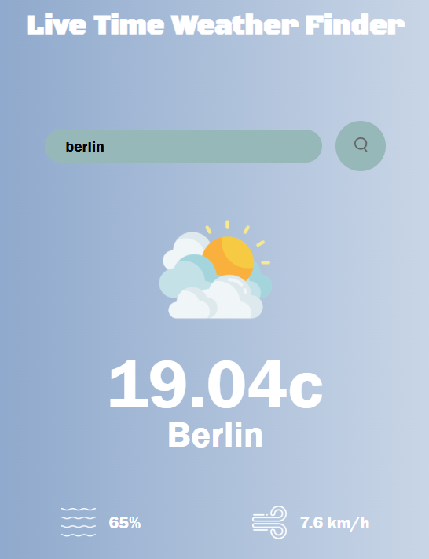
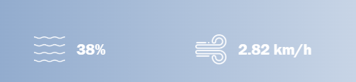

**Cool Weather Finder** 

This is a live time Weather Finder.This has Acess to thousands of locations around the world.

In this we give images according to weather condition

Also this also give Humidity and Wind Speed

You can also change the temperature unit from Celsius to Fahrenheit and Kelvin.

This is made using API and making into json

Languages Used:

1. HTML

2. CSS

3. JavaScript

If You like my Weather finder Give me a Star ⭐ 

Code URL to run on local in vs terminal or git bash :

git clone https://github.com/JazilJafar/Weather-Finder.git

Demo URl:

https://github.com/JazilJafar/Weather-Finder.git

made with love💖
